# LiaScript-DevServer: lms

**LiaLMS** brings a whole class into [LiaScript](https://LiaScript.github.io)
courses with AI agents: one computer of the teacher serves every learner and
author. Each of them signs in with a name and a password on a phone, tablet or
laptop and gets a copy of the course and an AI tutor of their own, in a chat over
the course. The teacher creates the users, hands out the courses, sees who is
stuck, reads along and writes to the class, all on one admin page.

It also does everything of [@liascript/mcp](https://www.npmjs.com/package/@liascript/mcp)
for a single person: the course in the browser with a chat to an AI agent such as
Claude Code, Codex, Gemini CLI or GitHub Copilot.

This is the package `@liascript/lms`, its commands are `liascript-lms` and the
shortcut `lialms`.

## Which package do I need?

| Package                                                                    | Command                     | For                                                                                                            |
| -------------------------------------------------------------------------- | --------------------------- | -------------------------------------------------------------------------------------------------------------- |
| [@liascript/devserver](https://www.npmjs.com/package/@liascript/devserver) | `liascript-devserver`, `liadev` | Previewing a course on your own computer with live reload. No AI.                                          |
| [@liascript/mcp](https://www.npmjs.com/package/@liascript/mcp)             | `liascript-mcp`, `liamcp`   | **You and one AI agent**: the agent runs on your computer and talks to you in a chat over the course.          |
| [@liascript/lms](https://www.npmjs.com/package/@liascript/lms)             | `liascript-lms`, `lialms`   | **A whole class**: one computer serves many learners and authors, each with a login and an agent of their own. |

All three can do everything the one above them does.

## LiaLMS: a whole class

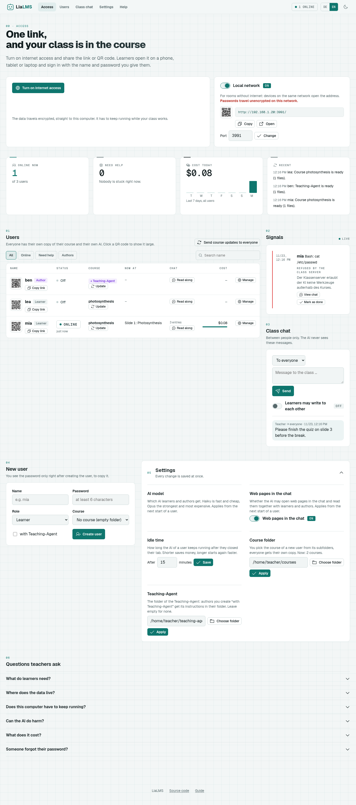

### How it works

You start `lialms --users <folder>` once, on your computer. That folder is the
**class folder**: every user gets a subfolder of their own in it, with a copy of
their course, their chats and their own AI agent. Learners reach your computer

- **over the internet** (`--share`): through
  [liascript.github.io/share](https://liascript.github.io/share/), encrypted end
  to end over WebRTC, from anywhere, without opening any port; or
- **in the local network** of the school (`--lan`): directly by the address of
  your computer, without internet. Plain HTTP: passwords cross the network
  unencrypted.

A learner opens the link or scans the QR code, signs in, and lands in their
course with the chat. Their agent starts when they sign in and stops 15 minutes
after their tab was closed (adjustable). Your computer has to keep running while
the class works.

### What you need

- [NodeJS](https://nodejs.org/en/download/) 20 or newer, and
  `npm install -g @liascript/lms`.
- **The AI**: by default [Claude Code](https://code.claude.com)'s agent. Either
  sign in once with `claude` on this computer (every agent then uses your
  login and its limits), or set `ANTHROPIC_API_KEY` (billed per use, the admin
  page shows the costs). `--agent codex` or `--agent gemini` take those
  instead. The adapters are fetched with `npx` on first use, so the first start
  needs the internet.
- **Linux with [bubblewrap](https://github.com/containers/bubblewrap)** (`bwrap`,
  e.g. `apt install bubblewrap`): every agent of Claude runs locked into the
  folder of its user, the rest of the system read-only. On other systems, or
  for another agent, start with `--no-sandbox`: then the agents can read
  everything your user account can. Only do that with people you trust.
- **Courses**: a folder with one subfolder per course, each holding at least
  one Markdown file (e.g. `courses/photosynthesis/README.md`).

### Quick start for teachers

1. Start it with your class folder and your courses:

   ```bash
   lialms --users ./class --courses ./courses --share
   ```

   Use `--lan` instead of `--share` in a room without internet, or both. The
   terminal shows what it did:

   ```text
   👥 users in ./class (0)
   👥 admin page: http://127.0.0.1:3000/?k=…
   📚 courses from ./courses (2)
   🔒 every agent in bubblewrap, in the folder of its user
   🔗 share: https://liascript.github.io/share/#room=…&key=…
   ```

2. The **admin page** opens in your browser. Only this computer can open it,
   and only with the key in its address (`?k=…`, kept as a cookie afterwards).
   Open it again from the terminal if you closed it.

3. Create your users under **04 New user**: a name (letters, digits, `-` and
   `_`), a password of at least 6 characters, the role and a course. The
   password shows once, to copy:

   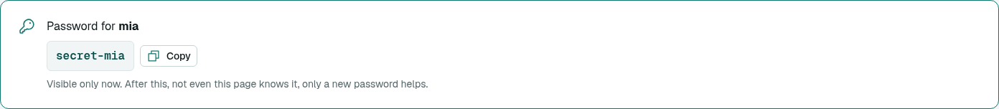

4. Hand out the access. Either one link for everyone (the big QR code under
   **00 Access**, on the projector), or each user's own QR code / `Copy link`
   in the list under **01 Users**, which already has their name filled in. The
   passwords you give them yourself.

5. Watch the class: who is online and where, who needs help, what it costs.
   Read along in any chat and write to everyone in the class chat.

Next time `lialms --users ./class` is enough: the other flags of the last start
are kept in `./class/.gateway.json`, and everything can be changed on the admin
page while it runs.

### What learners see

The link opens the sign-in page. With a personal link the name is filled in;
`Not you?` empties it. `Stay signed in on this device for 7 days` spares the
password next time. A forgotten password: you set a new one under `Manage`.

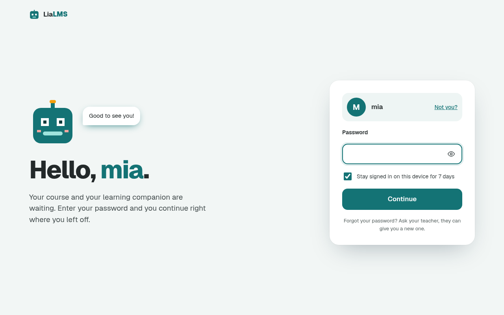

After the password a short welcome, teal for learners, indigo for authors:

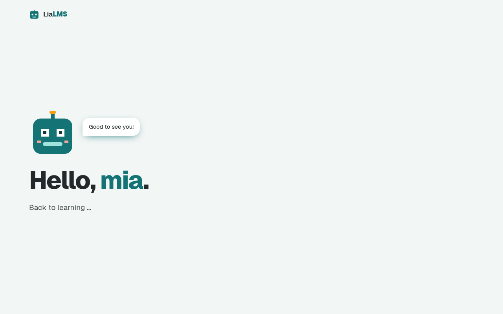

Then the course with the chat, exactly as described in [The chat](#the-chat).
A learner's agent greets first and lets them choose a historical teacher (see
[Teacher personas](#teacher-personas)); a course can fix the teacher with
`teacher:` in its header, or offer a few with `teachers: id1, id2`. When a
learner fails a quiz three times, gives up on it, or a code run fails three
times, the agent offers a hint by itself and the admin page marks them as
needing help.

The button with the two people in the bar of the chat (only in LiaLMS) is the
**class chat**: messages between people, which no AI ever sees. The badge
counts the unread ones. A message of the teacher also shows as a banner on top
of the chat, also when it came while the tab was closed:

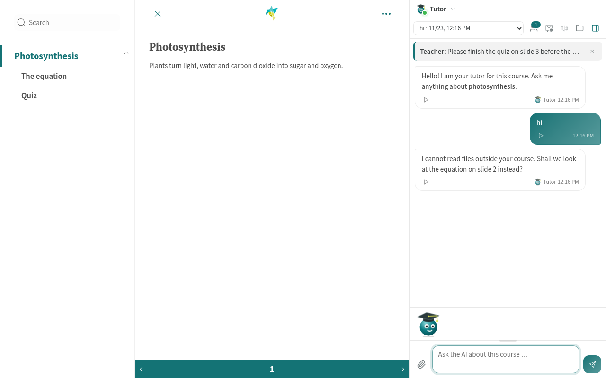

<p>
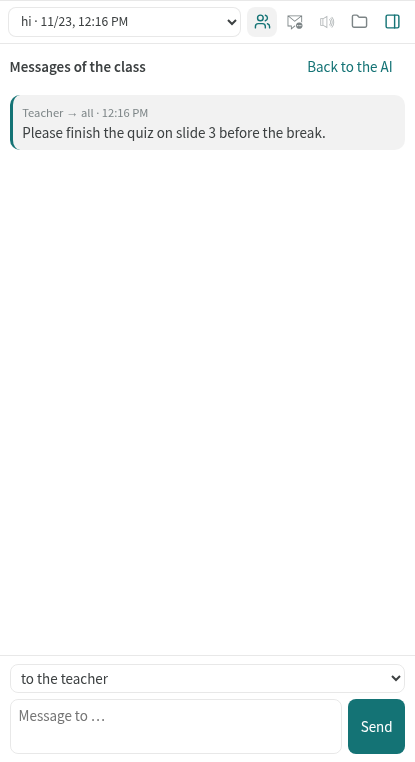
</p>

Learners write to the teacher always, to each other only while you allow it.

### Authors

A user with the role **Author** writes courses instead of taking them. Created
**with Teaching-Agent** (the checkbox shows when you started with `--kit`, or
chose its folder under **05 Settings**), they get the instructions of the
[Teaching-Agent](https://github.com/LiaScript/teaching-agent) in their folder;
their agent starts as course author, greets with the next steps and keeps
`journal.md` open. Get the kit once with
`git clone https://github.com/LiaScript/teaching-agent` and start with
`--kit ./teaching-agent`. An author's agent may run commands (inside the
sandbox), a learner's may not.

### The admin page, section by section

The bar on top: the sections, `● n ONLINE`, the language (`DE`/`EN`, German
by default without a browser language) and light or dark.

#### 00 Access

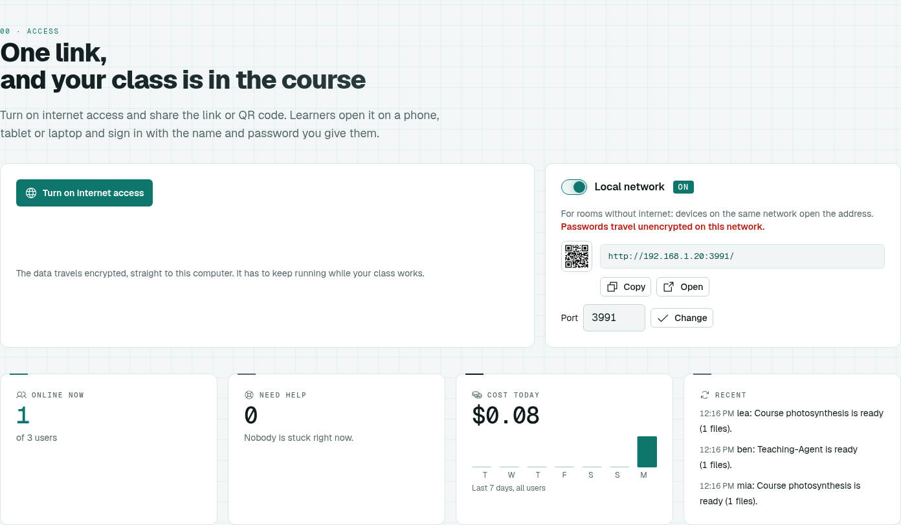

- **Internet access**: `Turn on internet access` starts sharing over
  liascript.github.io/share. Then: the big QR code (a click shows it large for a
  projector), `Copy link`, `Open`, and `New link`, which makes a new link: the
  old one stops working, also for learners who have it. Turning it off
  disconnects every open tab.
- **Local network**: the switch, each address of this computer with a small QR
  code, `Copy`, `Open`, and the port (default 8000, `Change`). Passwords travel
  unencrypted here.
- **The numbers**: `Online now`, `Need help` (with the names), `Cost today`
  with the last 7 days, and `Recent`: course copies and updates, with errors in
  red.

#### 01 Users

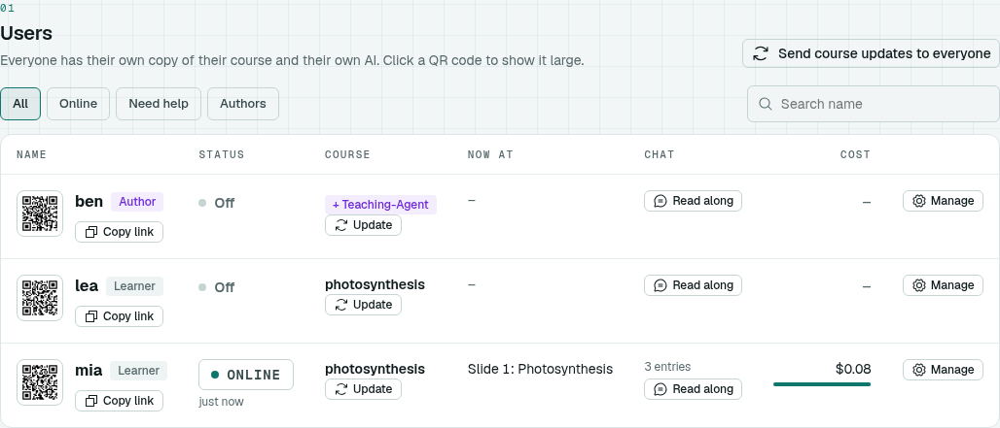

`All`, `Online`, `Need help`, `Authors` and `Search name` filter the list. Per
user:

| Column      | What it shows and does |
| ----------- | ---------------------- |
| **Name**    | The personal QR code (a click enlarges it) and `Copy link`, one per way in. Role badge `Learner`/`Author`, `Muted` if muted. |
| **Status**  | `Online`, `Tab closed` (signed in, but the tab is closed) or `Off`, with the time of the last activity. |
| **Course**  | The course and, for authors, `+ Teaching-Agent`. `Update` brings the newest version of the course (see below); a user without a course gets `Assign`. A running copy shows its progress. |
| **Now at**  | The slide the user looks at, and `Needs help` when they are stuck. |
| **Chat**    | The number of entries and `Read along`: the chat as the user sees it. |
| **Cost**    | What the agent of this user cost, with a bar. |
| **Manage**  | `New password` / `Set password` (signed-in tabs have to sign in again), `Mute in the class chat` / `Allow writing again`, `Delete` (the folder stays). |

`Send course updates to everyone` updates every user, one after the other.

#### 02 Signals

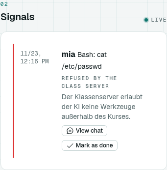

What needs you, newest first: red when an agent or the class server refused
something (a command, a file outside the user's folder: someone needs help or
is trying things out; the agent reports its own refusals with the tool
`report_refusal`, which only exists under `--users`), amber for learners who
are stuck. `View chat` opens the
chat, `Mark as done` clears a warning.

#### 03 Class chat

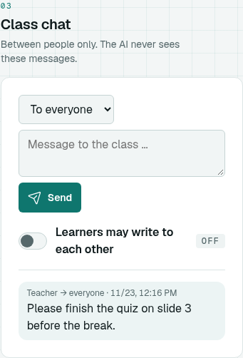

Write `To everyone` or to one user; it appears as a banner in their tabs.
`Learners may write to each other` allows messages between learners (off by
default). You see every message of the class.

#### 04 New user

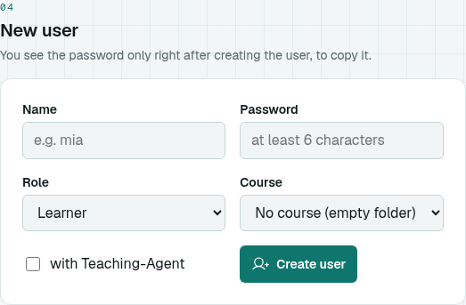

Name, password, role (`Learner`/`Author`) and course: `No course (empty
folder)`, one course of the course folder, or `All courses (a folder each)`,
where the user starts in the list of courses. `with Teaching-Agent` for
authors, see above.

#### 05 Settings

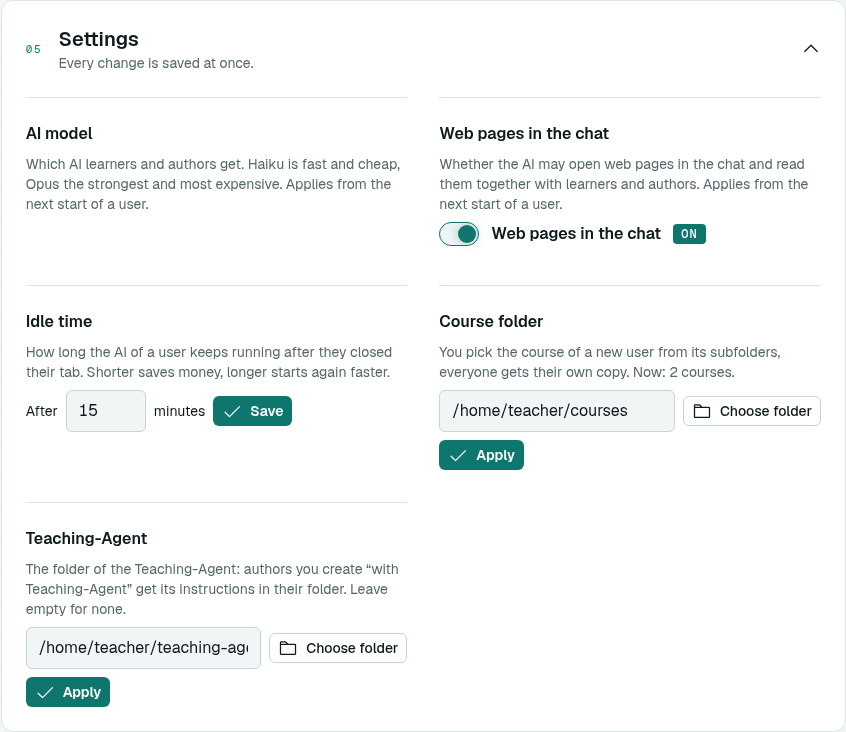

Saved at once, most of them apply from the next start of a user's agent:

- **AI model** for learners and for authors: `Default`, `Haiku (cheap)`, Sonnet,
  `Opus (expensive)`. Also as `--student-model` / `--author-model`. Only for
  `--agent claude`: another agent picks its model itself.
- **Web pages in the chat**: whether agents may open web pages with their
  users (see [Web pages](#web-pages)).
- **Idle time**: how long an agent keeps running after its user closed the tab
  (5 to 240 minutes, default 15). Shorter saves money, longer starts faster.
- **Course folder** and **Teaching-Agent**: chosen from the folders below your
  home folder.

#### 06 Questions teachers ask

Short answers to what teachers ask: what learners need, where the data lives,
whether the AI can do harm, what it costs, a forgotten password.

#### Read along

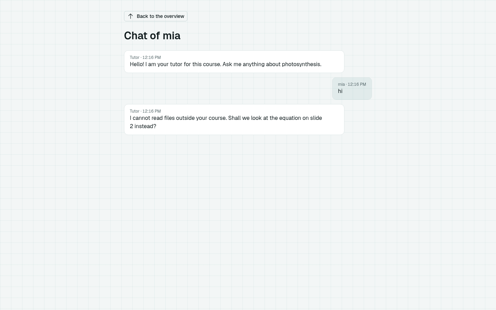

### Course updates

You change a course in the course folder, the users have copies. `Update`
compares file by file with the version the user got last time:

| The file was changed …         | After the update |
| ------------------------------ | ---------------- |
| only by you                    | your new version |
| only by the user               | the user's version stays |
| by both                        | the user's version stays, yours lands beside it as `README.update.md` |
| new in your course             | it comes |
| removed from your course, untouched by the user | it goes |

A user's own new files are never touched. Their agent stops for the update and
starts again with the next request. Copies and updates run in the background,
also for courses of gigabytes.

### Where the data lives

Everything stays on your computer, in the class folder:

| Path | What |
| ---- | ---- |
| `class/<name>/` | the user's course, `.chats/` with their chats and costs |
| `class/users.json`, `class/logins.json` | names, roles, courses, password hashes (scrypt) and sign-ins, readable only by you |
| `class/.class/` | the class chat and the warnings |
| `class/.gateway.json` | the settings and the admin key |
| `class/.homes/<name>/` | the agent's own home, e.g. the user's GitHub login for `git_login` |

Deleting a user keeps their folder. The share link is kept in
`~/.config/liascript/share.json`.

### The flags of LiaLMS

| Flag | What it does |
| ---- | ------------ |
| `--users DIR` | Starts LiaLMS with the class folder `DIR`. |
| `-p`, `--port` | The port of the admin page (default 3000). The users' devServers take ports from 4100 on. |
| `--share` | Internet access on (also a switch on the admin page). `--share-new`: a new link. |
| `--lan [PORT]` | The local network on, default port 8000. |
| `--courses DIR` | The course folder (default: the folder you start in). |
| `--kit DIR` | The Teaching-Agent for authors. |
| `--agent claude\|codex\|gemini\|<command>` | Which AI (default `claude`); any agent that speaks [ACP](https://agentclientprotocol.com). |
| `--student-model`, `--author-model` | The model per role, e.g. `haiku`. |
| `--no-sandbox` | Agents without bubblewrap. Never kept for the next start. |

`LIA_DEBUG=1` logs every prompt and tool call of the agents in the terminal.

### One person, without a class

`--agent` also works without `--users`: the devServer then starts the AI
itself, and you talk to it in the browser only, without an MCP client:

```bash
lialms --agent claude --live -i README.md
```

## Quick start

For you alone with an agent you start yourself (Claude Code, Codex, Copilot).
You need [NodeJS](https://nodejs.org/en/download/) and an AI agent that speaks
[MCP](https://modelcontextprotocol.io). The steps are for Claude Code, the
other agents follow below.

1. Install the devServer:

   ```bash
   npm install -g @liascript/lms
   ```

2. Make a folder for your course and prepare it:

   ```bash
   mkdir my-course
   cd my-course
   lialms init
   ```

   `init` needs no git. It writes into the folder:

   - the [Teaching-Agent](https://github.com/LiaScript/teaching-agent), the
     instructions that turn your agent into a course author: `CLAUDE.md`,
     `AGENTS.md`, `.codex/AGENTS.md`, `.github/copilot-instructions.md`,
     `.cursor/rules/agent.md`, `.windsurfrules` and `specs/`,
   - the [LiaScript skills](https://github.com/LiaScript/skills), the knowledge
     about LiaScript's syntax, templates, themes and exports, into
     `.claude/skills/` (Claude Code) and `.agents/skills/` (Codex, Copilot and
     others),
   - `.mcp.json` with the server `liascript` (`lialms --mcp --live -i journal.md`),
   - `.claude/settings.json`, which lets Claude Code start that server without
     asking.

   Files that are already there stay as they are. Later, `lialms update` fetches
   the Teaching-Agent and the skills again and replaces their files. Your own
   files are never touched: a `CLAUDE.md` that does not start with
   `# Teaching-Agent`, other skills and the other servers in `.mcp.json`.

3. Start your agent in that folder, `claude` in the terminal or Claude Code in
   VS Code, and say hello. It opens the preview with the chat in your browser:
   from now on you can talk to it there or in the terminal.

Already have a course? Skip `init` and put the [`.mcp.json`](#--mcp) next to
it, with your file after `-i`.

Other agents:

- **Codex**: add the server to `~/.codex/config.toml`, see [`--mcp`](#--mcp),
  or use the [persistent Codex bridge](#persistent-codex-bridge).
- **GitHub Copilot in VS Code**: VS Code starts the servers of `.mcp.json` by
  itself. Type `/mcp.liascript.chat` in the Copilot chat, otherwise Copilot does
  not hear what you write in the browser.
- **Claude Code in the terminal** reacts at once to a click in the course when
  started with `claude --dangerously-load-development-channels server:liascript`,
  see [Links that talk to the agent](#links-that-talk-to-the-agent).

## Installation

You can directly download the latest version for your system from the assets:

https://github.com/LiaScript/LiaScript-DevServer/releases/

or install it via the NodeJS package manager `npm` ...

### NodeJS

If you haven't installed it yet, you will have to install NodeJS for your
system. This is the actual runtime environment for your local server and also
contains the package manager that we will need for installing the
[LiaScript-DevServer](https://www.npmjs.com/package/@liascript/lms).

https://nodejs.org/en/download/

### LiaScript-DevServer

Open the terminal on your system and type the following command.

```bash
npm install -g @liascript/lms
```

This will automatically install all dependencies and the devServer as well ...

> **Note:** On Windows you open a terminal by typing `cmd` into the program
> search or you can also use the Powershell.

## Usage

You can run the devServer by typing `liascript-lms` or the short-cut
`lialms` into your terminal. The following command will print out some help
information on command-line parameters that you can use:

```bash
liascript-lms --help
```

```text
 _     _       ____            _       _
| |   (_) __ _/ ___|  ___ _ __(_)_ __ | |_
| |   | |/ _` \___ \ / __| '__| | '_ \| __|
| |___| | (_| |___) | (__| |  | | |_) | |_
|_____|_|\__,_|____/ \___|_|  |_| .__/ \__|
                                |_|

init             put the teaching agent, the LiaScript skills and a
                 .mcp.json into this folder, keeps existing files
update           fetch the teaching agent and the skills again,
                 replaces their files, keeps .mcp.json

-h  --help       show this help
-v  --version    show version information
-i  --input      input README.md file or folder (default: .)
-n  --hostname   hostname of your server (default: localhost)
-p  --port       used port number (default: 3000)
-l  --live       do live reload on file change
-w  --watch      file types that trigger the live reload,
                 comma separated, * for all, implies --live,
                 hidden files and node_modules never count
                 (default: md,html,htm,js,css,png,jpg,jpeg,gif,svg,webp,avif,bmp,ico,mp4,webm,ogv,ogg,mov,m4v)
-o  --open       open in default browser
-t  --test       test online on https://LiaScript.github.io
    --mcp        serve as MCP server on stdio for AI agents,
                 to be started from the MCP config of the agent
    --agent      start an AI for the chat over ACP: claude (default),
                 codex, gemini or the command of an ACP agent
    --users      DIR: one start for many users, each logs in over
                 the share link and gets DIR/<name> and an agent
                 of their own (with --share); -p is the port of
                 the admin page, which opens by itself and sets
                 the rest; the flags of a start are kept for the
                 next one in DIR/.gateway.json (never --no-sandbox)
    --lan        [PORT] --users also on the network of the school,
                 without share page and internet (default: 8000)
    --no-sandbox the agents of --users without bubblewrap
    --student-model, --author-model  the model of the agents of
                 that role (ANTHROPIC_MODEL), e.g. haiku; the key
                 comes from ANTHROPIC_API_KEY, else your login
    --kit        DIR: the Teaching-Agent (its CLAUDE.md, AGENTS.md,
                 specs/) for authors of --users, chosen per user
    --courses    DIR: its subfolders are the courses the admin
                 page copies for a new user (default: .)
    --share      share it over WebRTC, prints a link for other
                 browsers; --share URL names the share page
                 (default: https://liascript.github.io/share/);
                 the link stays the same for this folder
    --share-new  a new link, the old one stops working
    --share-web  the share page under another origin, for web
                 pages (default: the other one of localhost and
                 127.0.0.1, else none)
    --proxy      web pages in the chat of --mcp: off, read (default:
                 the document only, no logins) or full (experimental:
                 everything, cookies, forms, single page apps; some
                 sites hang Firefox, the browser extension is safer)

-r  --responsiveVoice  add optional responsiveVoice support,
                       or pass your own responsiveVoice key.
                       Adding this feature might slow down
                       the reloading speed.
                       For more information visit:
                       https://responsivevoice.org
```

> **Note:** `-h` or `--help` will only print out the help, all other parameters
> are ignored.

### `--version`

Use this to identify the current version, but you can alternatively also use the
shortcut `-v`:

```bash
liascript-lms --version
```

At the moment this should give the following results. Since LiaScript gets
updated separately, we use two different version, one for the devServer and one
for LiaScript.

```text
DevServer: 1.5.1
LiaScript: 2.7.0
```

### `--input`

If you run the command `liascript-lms` without any commands, the server
will run from your current directory and give you the following output.

```text
$ liascript-lms

 _     _       ____            _       _
| |   (_) __ _/ ___|  ___ _ __(_)_ __ | |_
| |   | |/ _  \___ \ / __| '__| | '_ \| __|
| |___| | (_| |___) | (__| |  | | |_) | |_
|_____|_|\__,_|____/ \___|_|  |_| .__/ \__|
                                |_|

📡 starting server
   - local:           http://localhost:3000
   - on your network: http://192.168.2.114:3000
✨ hit Ctrl-c to close the server
```

The server starts locally on port 3000, thus, if you open your browser and type
in the URL http://localhost:3000 you should see a similar image

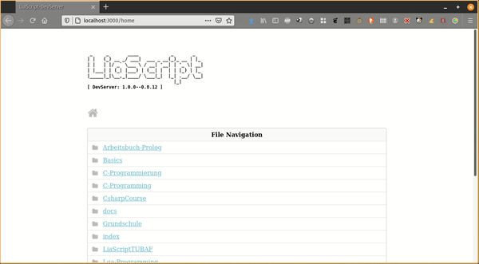

However, if you add the `--input` parameter (shortcut `-i`) and pass it another
folder, this will be used as the root folder for the subsequent navigation.

```bash
liascript-lms --input ../LiaBooks
```

But you can also refer to a specific Markdown file, in this case, the course
will be rendered immediately by the LiaScript interpreter, if you open the
following link in your browser.

```bash
liascript-lms --input ../LiaBooks/docs/README.md

...
📡 starting server
   - local:           http://localhost:3000/liascript/index.html?http://localhost:3000/README.md
   - on your network: http://192.168.2.114:3000/liascript/index.html?http://192.168.2.114:3000/README.md
✨ hit Ctrl-c to close the server
```


### `--open`

**If you want to open the preview immediately, then use this parameter.** It
will open your default browser with the displayed URL automatically.

```bash
liascript-lms --open -i ../LiaBooks
```

### `--live`

Use this parameter if you want to have live updates. The server will monitor
file changes within the defined folder. When you type and save your document, a
reload will be automatically triggered. If you prefer to reload your changes
manually via pressing `F5` do not use this option.

```bash
liascript-lms --live -o -i ../LiaBooks/docs/README.md
```


The server watches the folder of the course, also if you pass a single file, so
a changed image or stylesheet reloads the course too. Hidden files and folders
(such as `.git`) and `node_modules` never trigger a reload, and only files of
these types count: Markdown, HTML, JavaScript, CSS, images and videos (`md`,
`html`, `htm`, `js`, `css`, `png`, `jpg`, `jpeg`, `gif`, `svg`, `webp`,
`avif`, `bmp`, `ico`, `mp4`, `webm`, `ogv`, `ogg`, `mov`, `m4v`).

### `--watch`

Sets the file types that trigger a live reload, as a comma separated list of
extensions, and turns on `--live`. It replaces the default list, `*` watches
every visible file.

```bash
liascript-lms --watch md,css,png -i ../LiaBooks
```

### `--port`

It is only possible to run on devServer at a given port-number, thereby 3000 is
used as the default value. If you want to start multiple servers on different
folders or the port-number is already occupied by another process or server,
this will will be shown by the following error message:

```bash
liascript-lms -o -i ../LiaBooks

...
📡 starting server
   - local:           http://localhost:3000/liascript/index.html?http://localhost:3000/README.md
   - on your network: http://192.168.2.114:3000/liascript/index.html?http://192.168.2.114:3000/README.md
✨ hit Ctrl-c to close the server
🚨 error => listen EADDRINUSE: address already in use :::3000
```

However, by using `--port 3001` or `-p 3001` you can redefine this number and
run different servers separately:

```bash
liascript-lms --port 3001 -o -i ../LiaBooks

...
📡 starting server
   - local:           http://localhost:3001/liascript/index.html?http://localhost:3001/README.md
   - on your network: http://192.168.2.114:3001/liascript/index.html?http://192.168.2.114:3001/README.md
✨ hit Ctrl-c to close the server
```

### `--test`

Since we are using a local devServer, it is also possible to test your courses
online on the LiaScript project website: https://LiaScript.github.io

See how the URL changes by setting the parameter `--test`:

```bash
liascript-lms --test -o -i ../LiaBooks/docs/README.md

...
📡 starting server
   - local:           https://LiaScript.github.io/course/?http://localhost:3000/README.md
   - on your network: https://LiaScript.github.io/course/?http://192.168.2.114:3000/README.md
✨ hit Ctrl-c to close the server
```

> **Note:** Live reload with `--live` will not work in this mode, since the
> server is only used to serve local data and not the LiaScript website.
> Additionally you will have to remove the courses manually from the index.

### `--responsiveVoice`

Automated Text2Speech is **Not** enabled by default, since it reduces the reload
speed. But you can add this support by add this parameter, in this case the
LiaScript project key is automatically injected. However, you can also pass your
own key from your own project/website like this:

```bash
$ liascript-lms --responsiveVoice YOURKEY -i ../LiaBooks
```

### `--hostname`

The name the server puts into the addresses it prints and hands out, `localhost`
by default (shortcut `-n`). Use it when the course should be reached under
another name, for example the name of your computer in the network:

```bash
liascript-lms --hostname my-laptop.local -i ../LiaBooks
```

With `--mcp` the server listens on this computer only, whatever the name.

### `--share`

Opens the preview on a phone or another computer, see [On a phone](#on-a-phone).
Without `--mcp` the terminal prints the link; with `--mcp` the 📱 button of the
chat switches it on and off. `--share-new` replaces the link, the old one stops
working. `--share-web` is only needed for web pages through the link, see
[Web pages](#web-pages).

### `init` and `update`

See the [quick start](#quick-start).

### `--mcp`

Connects the preview to an AI agent such as Claude Code, Codex or Gemini CLI.
With this parameter the devServer is additionally an
[MCP](https://modelcontextprotocol.io) server on stdio. You do not start it
yourself, the agent does. For Claude Code put this `.mcp.json` next to your
course:

```json
{
  "mcpServers": {
    "liascript": {
      "command": "lialms",
      "args": ["--mcp", "--live", "-i", "README.md"]
    }
  }
}
```

For Codex add this to `~/.codex/config.toml`. Codex gives up on a tool call
after 60 seconds by default, which is too short for a question the user has to
answer:

```toml
[mcp_servers.liascript]
command = "lialms"
args = ["--mcp", "--live", "-i", "/path/to/README.md"]
tool_timeout_sec = 3600
```

Every agent starts a devServer of its own. If the port is taken, the next free
one is used, so several of them can run from the same config, and the agent
learns the address from `get_state`. This matters in VS Code, which starts the
servers of a `.mcp.json` in the workspace for Copilot as well, next to the one
Claude Code starts. Do not start `--mcp` yourself in a terminal: nothing can
connect to that instance.

The preview opens in your default browser. If the agent has browser automation
tools, such as the MCP servers of Playwright or Chrome DevTools, it is told to
open the preview in that browser instead, as long as no tab is connected yet.
You and the agent then look at the same tab, and the agent can take
screenshots, read the console and click in the course. Open the preview
yourself first if you prefer your own browser: the agent uses the tab that is
there and never opens a second one.

The agent gets these tools:

| Tool             | What it does                                                                                                   |
| ---------------- | -------------------------------------------------------------------------------------------------------------- |
| `get_state`      | the open course, the slide (1-based, like `#3` in the URL), its title, the text you have selected, and whether the browser can read aloud |
| `goto`           | show a `slide`, the slide of a source `line` or `section`, another course `file`, or a web page `url`; opens the browser if it is not open |
| `chat`           | write into the chat on top of the course, optionally with buttons, radio buttons, checkboxes or teacher portraits for you to answer; with only `status` it sets the progress line |
| `set_agent`      | who you talk to: the name, label and robot of the current agent, the list of agents in the menu, a teacher persona and its voice, the author or learner view |
| `find_teacher`   | the historical teacher personas, filtered by topic, gender and region, see [Teacher personas](#teacher-personas) |
| `read_chat`      | read the saved chat, so that an agent can continue a conversation it did not start                               |
| `wait_for_event` | fallback for agents that cannot be notified, see below                                                         |
| `outline`        | the table of contents of a long Markdown file: every heading with its slide, line and size                    |
| `read_section`   | one section of a Markdown file, by heading path, slide or line, by default the slide you look at               |
| `write_section`  | replace or append one section; it refuses if you changed that section since the agent read it                  |
| `run_in_page`    | run JavaScript in a web page shown in the chat, to read or mark it; only when you ask for it                   |
| `share`          | the 📱 link for a phone, see [On a phone](#on-a-phone)                                                          |
| `git_login`      | log in to GitHub: the agent gives you a link to a local page where you paste a [token](https://github.com/settings/tokens/new?scopes=repo&description=LiaScript%20DevServer), the agent never sees it |
| `git_status`, `git_clone`, `git_sync`, `git_tag` | git without an installed git: changes and last commits, clone, commit + pull + push, tag a version |
| `git_publish`    | a new GitHub repository for the course, with description, topics and the LiaScript link as website            |

The token is kept in `~/.config/liascript/github.json` and sent to github.com
only. `git_sync` does not merge conflicts: it stops before anything is merged
or pushed.

#### Reading aloud

LiaScript reads a course aloud with the speech voices of the browser. The
devServer reports to the agent how many voices the browser has, and when there
are none, `get_state` carries a `tts` entry that says why and what helps. The
agent is told to change nothing without asking you.

The chat uses the same voices: every message has a small button that reads it
aloud in the language of the course, without code blocks, tables and diagrams.
A browser without voices shows no such button. The agent can say that a
message is in another language, and mark single passages, so that each part is
read with a matching voice.

| Browser                                   | Why it is silent                                                                  | What helps                                                                 |
| ----------------------------------------- | --------------------------------------------------------------------------------- | -------------------------------------------------------------------------- |
| Chrome started by the Playwright MCP      | it starts Chrome with `--disable-component-extensions-with-background-pages`, which removes Chrome's online voices | a config file that drops the flag, see below (checked with Playwright MCP 0.0.83, Chrome 154) |
| Chrome started by another automation tool | the same flag                                                                     | start Chrome without it                                                    |
| Firefox on Linux                          | it takes its voices from `speech-dispatcher`                                      | install `speech-dispatcher` with a voice                                   |
| any browser                               |                                                                                   | start the devServer with `--responsiveVoice <key>` and a valid key, that service needs no browser voices |

For the Playwright MCP, write this into a file and pass it with `--config` or
the environment variable `PLAYWRIGHT_MCP_CONFIG`, then restart that server:

```json
{
  "browser": {
    "launchOptions": {
      "ignoreDefaultArgs": ["--disable-component-extensions-with-background-pages"]
    }
  }
}
```

The voices of Chrome are online voices of Google: the text that is read goes
to Google, and without a connection it stays silent.

#### Links that talk to the agent

A link with the scheme `agent:` sends a command to the agent when you click it.
The message is the link itself, `agent:<agent>/<command>?<parameters>`. Written
as `agent://<agent>/<command>?<parameters>` it means the same:

```markdown
[Explain this simpler](agent:tutor/explain?level=easy)

<button data-agent="agent:author/rewrite?tone=short">Shorten this section</button>

[Give me an exercise](#)<!-- data-agent="agent:tutor/exercise?n=3" -->
```

The agent receives the agent name, the command and the parameters together
with what you are looking at: file, slide, title and selected text. What
`tutor` or `explain` mean is up to you. Define them as sub-agents, skills or
simply in the instructions of your agent. The same links work in the chat, so
the agent can offer them to you as well.

Outside of the devServer such a link leads nowhere; the `data-agent` forms are
inert there.

Claude Code is told about a click at once, in one of two ways:

- Its [channels](https://code.claude.com/docs/en/channels) are a research
  preview and work only in the terminal, not in the chat panel of the VS Code
  extension. The session has to be started like this:

  ```bash
  claude --dangerously-load-development-channels server:liascript
  ```

- Otherwise it listens with its Monitor tool, in the terminal and in VS Code
  alike. `get_state` gives it the address of an event stream, the agent runs
  `curl -sN` on it in the background, and every click wakes it up. The agent is
  told to do so, there is nothing to set up. While it listens, forms in the
  chat do not keep it waiting; your answer arrives like a click.

For Codex, call `wait_for_event` with `{ "timeout_s": 0 }` between work steps:
it returns the next queued event immediately, or `{ "timeout": true }`.
Post forms with `chat({ markdown, inputs, wait: false })`; this returns
`{ sent: true, ask }` immediately and the answer arrives as an `answer` event.
Without these options, `wait_for_event` and forms retain their waiting behavior.
The fallback queue keeps only the latest 20 events, so poll regularly.

GitHub Copilot and other clients cannot be woken up by the server. Start the
prompt `chat` of the server instead (in VS Code: type `/mcp.liascript.chat` in
the Copilot chat): the agent then waits with `wait_for_event` (25 s per call),
answers in the browser and waits again, until you stop it or close the
preview. VS Code asks to continue after `chat.agent.maxRequests` requests
(default 50, each wait counts), raise it for long sessions.

#### Persistent Codex bridge

With Codex CLI installed and signed in (`codex login`), run the bridge from
the course project folder. After installing this package:

```bash
liascript-lms-codex -- --live --open -i README.md -p 3001
```

From this repository, build first and run:

```bash
npm run build
npm run codex -- -- --live --open -i test.md -p 3001
```

Options before `--` belong to the bridge (`--model MODEL`, `--codex PATH`);
options after it belong to the devserver. Use a free port if another MCP
client already runs the devserver. The bridge owns one MCP subprocess and
one [Codex app-server](https://developers.openai.com/codex/app-server).
It consumes MCP event notifications directly, forwards browser input with
`turn/start` or `turn/steer`, and exposes the existing MCP tools to Codex as
dynamic tools with a `lia_` prefix. There is no polling turn or Monitor timeout.
This requires app-server's experimental dynamic tools API (tested with Codex
CLI 0.160.0); no additional runtime dependency or separate API key is needed
when Codex is already signed in.

MCP agents receive these startup instructions in the `get_state` tool
description. Its `codex_bridge` result supplies the installed program path,
argument array, working directory and availability. Codex can use them to
start a background PTY and open the URL printed after `Bridge ready:`. The
description explicitly distinguishes that new thread from an existing IDE
session and tells an agent already using `lia_` tools to keep its current bridge.

Type in the browser or in the bridge terminal: both reach the same thread.
Final replies appear in both, progress appears in the browser status line,
and forms always return immediately. `/stop` interrupts the current turn;
`/quit` stops both subprocesses. Closing the browser interrupts active work
after the usual disconnect delay, without opening it again.

Run one bridge per project. Each saved browser chat has its own Codex thread.
The local mapping lives in
`.chats/.codex-threads.json`; restart the bridge to resume it, or use the
browser chat menu to change conversations. This mapping belongs to the
local Codex login, so exclude it from version control even if you share the
chat transcripts. A resumed thread on another machine must be created there.
The bridge hosts its own conversation; it does not inject messages into an
already-running IDE chat.

Browser input remains untrusted page content. Command/file approvals appear
only in the bridge terminal: `/approve ID yes` or `/approve ID no`. Other
structured requests show their payload and accept `/reply ID JSON`. Browser
text never invokes these terminal commands. Codex runs with `workspace-write`
and `on-request`; managed Codex requirements continue to apply.

Checks after building:

```bash
npm run test:mcp
npm run test:codex
npm run test:codex -- --live
```

The normal bridge check uses the real MCP server and a deterministic
app-server peer. The live check uses the signed-in Codex and a visible
Playwright Chromium window; it verifies browser/terminal input, steering,
forms and resume after restart. It needs Playwright and its browser already
installed. Set `PLAYWRIGHT_MODULE_PATH` to an installed Playwright module
directory and optionally `PLAYWRIGHT_CHROMIUM_PATH` to an existing Chromium
binary. `HEADLESS=1` runs without a window. Test transcripts and screenshots
are written to a temporary folder printed at the end.

Closing the preview is an event as well: two seconds after the last browser
went away the agent is told that nobody is looking anymore, a form it was
waiting for ends, and it is asked not to reopen the page on its own. A reload
is too short to count.

#### The chat

In this mode a course opens inside a page with a chat on top of it. The course
lives in a frame of its own, so the chat stays when the course reloads. What
you type goes to the agent, and its answers are LiaScript, rendered by
[@liascript/chat](https://www.npmjs.com/package/@liascript/chat) like a course:
formulas, quizzes, surveys and tasks, executable code, ASCII art, and templates
imported in a header comment. Your answers to its quizzes reach the agent too, so
it can help when you are stuck. The chat speaks the language of the course
(English and German so far).

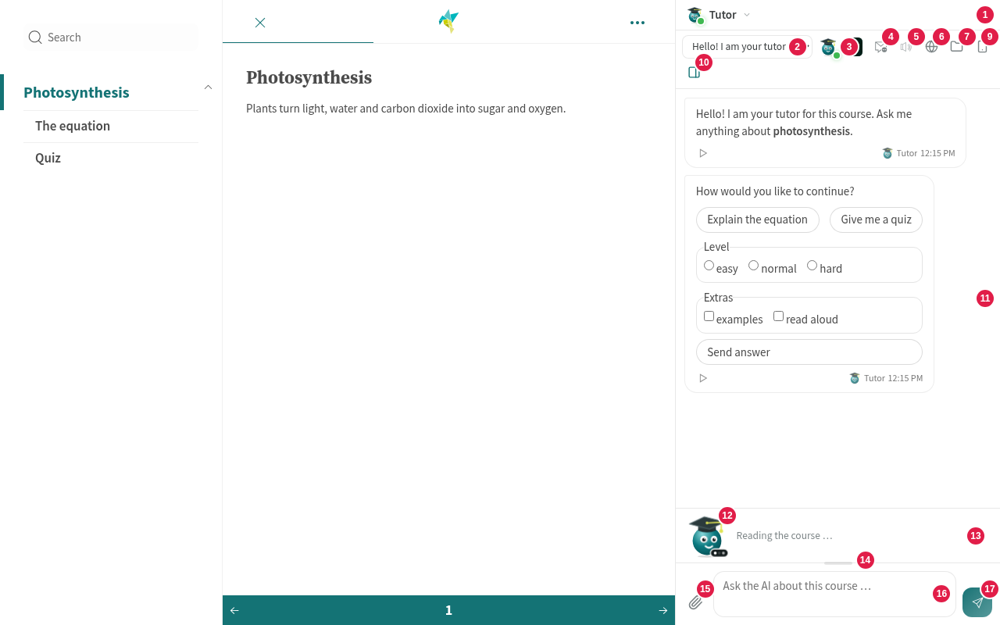

| #  | Control                    | What it does |
| -- | -------------------------- | ------------ |
| 1  | **Agent button**           | Robot and name of the agent you talk to; the green dot marks it. A click closes the chat to this button and opens it again. While the chat floats, drag it here to move it. |
| 2  | **Chat menu**              | Every saved conversation, titled with your first message, and `+ New chat`. Pick one to continue it: the agent is told and reads it first. |
| 3  | **Agents**                 | One robot per agent, shown when the agent works with two or more (e.g. a tutor and an author). A click switches whom you talk to. |
| 4  | **New chat**               | Starts a new conversation, the same as `+ New chat` in the menu. An empty chat is not saved. |
| 5  | **Read everything aloud**  | When switched on, every new message and the agent's progress lines are read aloud as they arrive. Remembered in this browser. Without speech voices a muted speaker shows here instead, see below. |
| 6  | **Web page** 🌐            | Opens an address field: type an address and the page opens in place of the course, the chat stays. See [Web pages](#web-pages). |
| 7  | **Files** 📁               | The file listing of the folder of the course in the frame. Its links open other courses and files of the project. |
| 8  | **Back to the course** ⌂   | Shows only while the frame shows something else than the course the server started with; leads back to it. |
| 9  | **Phone** 📱               | Shows a QR code and a link that opens this course and chat on a phone, see [On a phone](#on-a-phone). Highlighted while sharing. |
| 10 | **Dock / float**           | Docked, the chat is a column at the right edge and the course ends left of it; floating, it hovers over the course. Only on windows of 768 px and wider. Remembered. |
| 11 | **Messages**               | The conversation. Each message of the agent has a read-aloud button ▷ and a footer with the agent's robot, name and time. A link to `#3` moves the course to slide 3. |
| 12 | **Stage**                  | The robot of the current agent. Its bottom row runs while the agent works, it pulses while a question waits for you, and it moves its mouth while a message is read aloud. |
| 13 | **Progress line**          | What the agent is doing, e.g. `Reading the course …`. After 20 s it counts the seconds. |
| 14 | **Input height**           | Drag the small bar to make the input taller (up to 60 % of the chat), or use the arrow keys on it; a double click resets it. Remembered. |
| 15 | **Attach** 📎              | Sends files to the agent (up to 25 MB each). They land in `uploads/` of the project and appear in the chat as image, video, audio or link. Dropping a file on the chat does the same. |
| 16 | **Input**                  | Your message. `Enter` sends, `Shift`+`Enter` starts a new line. |
| 17 | **Send**                   | Sends the message. A message that does not reach the server, e.g. while it restarts, is kept and gets a `Send again` button. |

The chat floating over the course (10), and closed to its button (1):

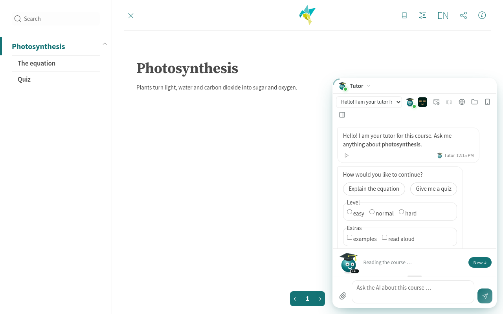

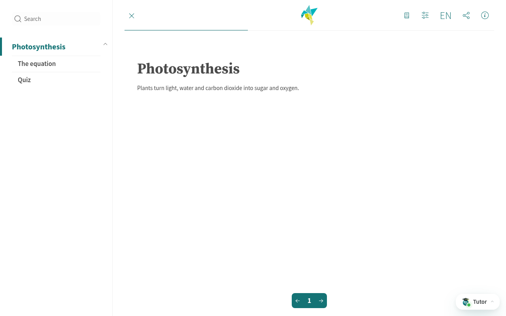

Floating, the grip in the top left corner resizes the chat; docked, the left
edge of the column moves the border between course and chat. Place, size and
mode are remembered in this browser.

##### Questions of the agent

The agent can ask with buttons, radio buttons and checkboxes. A form with a
single row of buttons is answered by a click; a form with more than one
question has `Send answer`. Only the newest question can be answered: when the
agent asks again or you answer by typing, the older form is closed with a note.

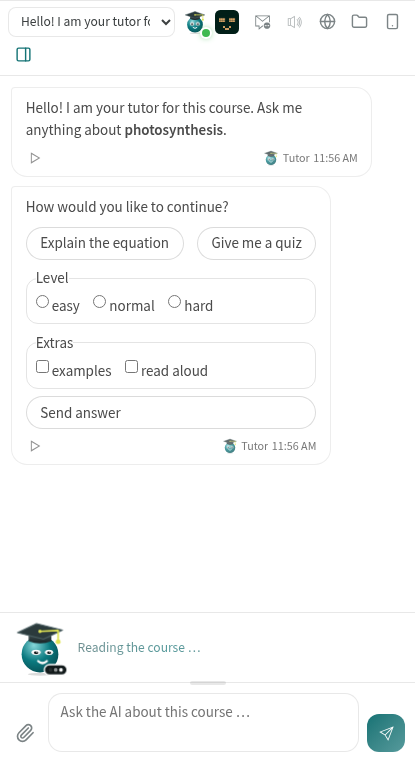

After the answer the form folds to what you chose, and your choice appears as
your own message:

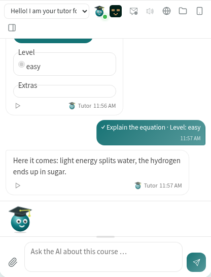

##### Below the messages

- **`New ↓`** shows when new messages arrived below what you are reading, and
  jumps to them. The chat keeps the first new answer of the agent in view
  instead of scrolling to the very end.
- **`Open question ↓`** (or `↑`) shows when a question of the agent waits for
  you out of sight, and jumps to it.
- **`Stop`** next to the robot shows while something is read aloud. It stops
  reading and drops what was still queued.
- **Hints below the progress line**: `Waiting for the assistant…` appears as
  soon as your message arrived. If the agent did not react after 30 s, a hint
  says it may not be connected; the message is saved and answered once it
  starts. If a working agent is silent for a minute (e.g. it waits for a
  permission in the terminal), the hint says it is still working.
- A gap of an hour or a new day puts the time above the next message.

##### Reading aloud and the muted speaker

The ▷ button of a message reads it aloud, ■ stops it. Code and diagrams are
skipped; tables, the options of a quiz (never its solution) and formulas are
read, an image by its alt text. A
browser without speech voices shows a muted speaker instead of (5); a click
explains why and what helps, see [Reading aloud](#reading-aloud):

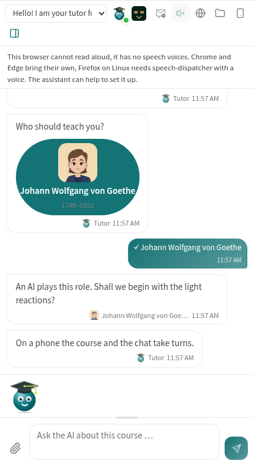

##### Files, other courses and web pages

The address field of 🌐 (6):

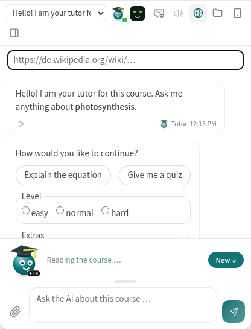

While another file is open, ⌂ (8) leads back to the course and 📁 (7) to the
folder:

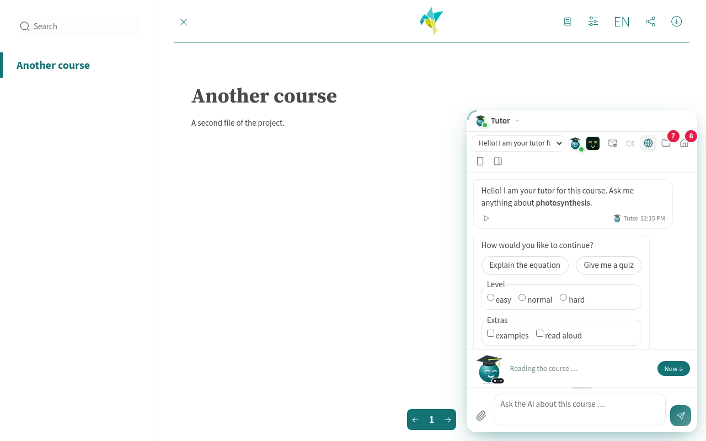

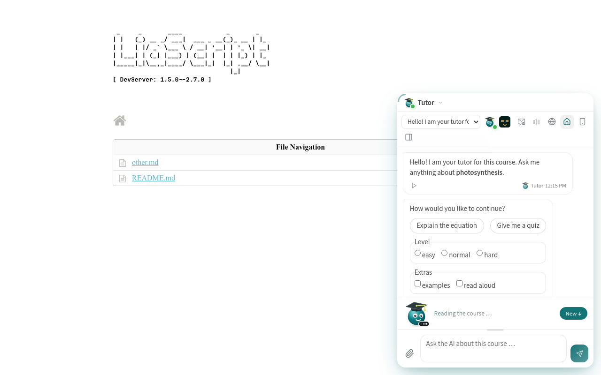

##### Where the chats are saved

Every chat is saved as a file in `.chats/` of the folder the agent works in, one
file per conversation, together with your answers to its forms and the states
of the quizzes in its messages. A reload of the page, a restart of the agent or
the server continue the last chat; the chat menu (2) starts a new one or reopens
an older one, and the agent is told which. Commit `.chats/` so that others can
continue your conversations, or add it to `.gitignore` to keep them to yourself.

#### On a phone

The 📱 button in the bar of the chat opens the same course and chat on a phone
or on another computer: it shows a QR code and a link to
[liascript.github.io/share](https://liascript.github.io/share/), which reaches
this server over an encrypted WebRTC connection. You navigate there as here, and
the agent answers there too; on a small screen course and chat take turns, a bar
at the bottom switches. You can also ask the agent to share it. The link stays
the same for the project and the sharing comes back after a restart, until you
stop it with the same button. Anyone with the link sees the course and the chat
and can write to the agent. Web pages of `--proxy full` do not pass.

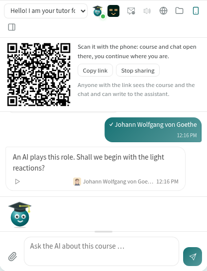

`Copy link` copies the link, `Stop sharing` ends it: the link stops working
until you switch it on again, then it is the same link.

On a screen narrower than 768 px course and chat take turns. The bar at the
bottom switches: `Course` with the number of the slide, `Chat` with the number
of messages you have not seen yet. While the course shows, the newest message
of the agent (or its progress line) peeks above the bar; a tap opens the chat.
In the chat, the strip at the top tells where the course is and leads back
with `To the course`. A question of the agent opens the chat by itself, a
`goto` of the agent the course.

<p>
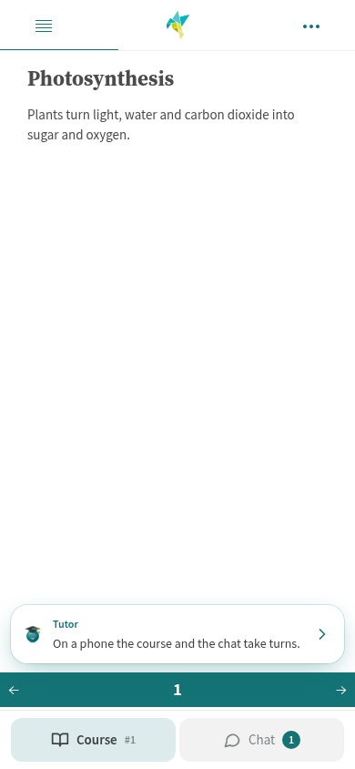
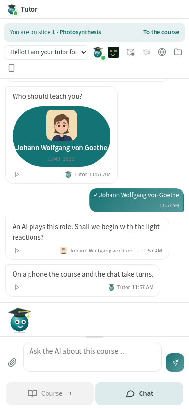
</p>

#### Web pages

The chat can show any web page in place of the course, so you can read it
together with the agent: open it with 🌐, ask the agent, or click a link to
another site in a course. `--proxy` decides how:

- `read` (default): the devServer fetches the page for the frame, without your
  cookies or logins. Styles, images and scripts load from the site itself.
  Single page apps may break.
- `off`: no web pages; 🌐 is hidden and links to other sites open in a new tab.
- `full` (experimental): everything goes through the devServer, with cookies,
  forms and single page apps, in memory only. Some sites hang Firefox.

For pages with your own logins (a forum, an LMS, social media) the browser
extension in the folder
[`extension/`](https://github.com/LiaScript/LiaScript-DevServer/tree/lms/extension)
of the repository works better than `full`. It lets the chat load the real page
directly, in this browser tab only. It is not in the npm package; download the
folder and load it:

- Chrome, Edge: `chrome://extensions`, switch on *Developer mode*, *Load
  unpacked*, choose the folder.
- Firefox (128 or newer): `about:debugging`, *This Firefox*, *Load Temporary
  Add-on…*, choose `manifest.json` (until Firefox restarts).

The agent can read the whole page or mark parts of it with `run_in_page`, but
only when you ask it to, and only through the proxy, not with the extension.

#### Teacher personas

An agent can teach as a historical person: Marie Curie, Socrates, Hypatia,
Paulo Freire and nearly 200 more, with a portrait, a voice and their way of
teaching. The agent suggests a few that fit the course, the learner picks one in
the chat. Then the chat switches to the learner view, which shows only that
teacher; ask the agent to go back to the author mode to see all agents again.

<p>
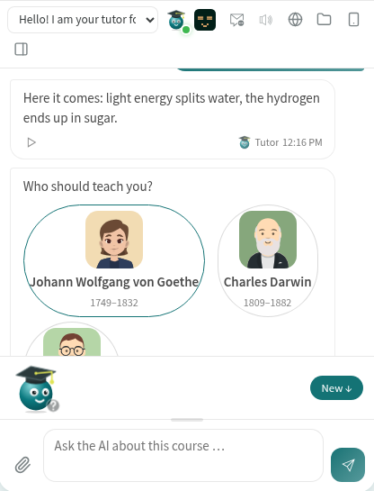
</p>

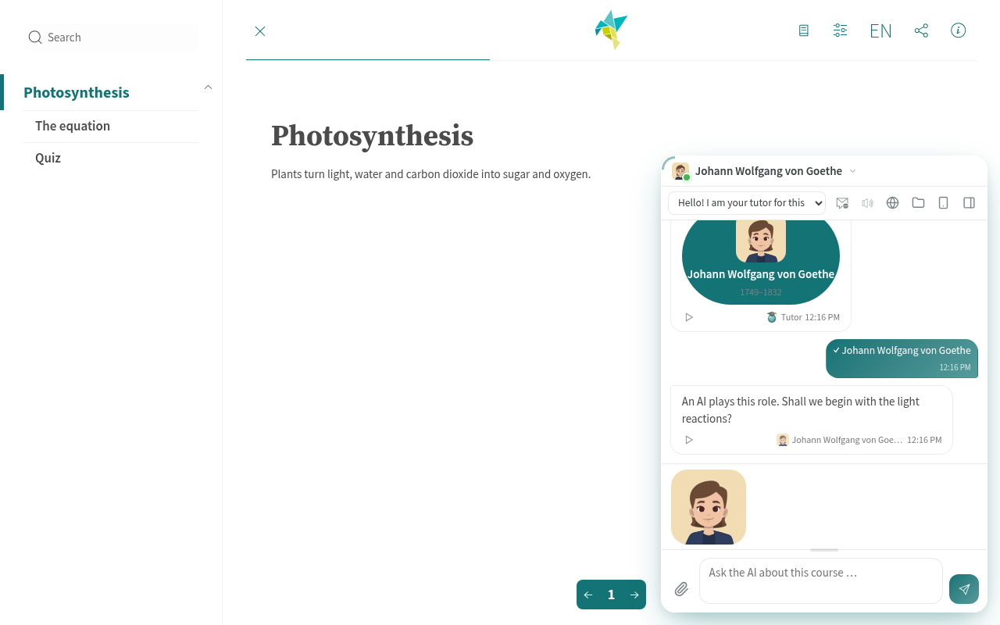

A course can fix its teacher in the header:

```markdown
<!--
author: …
teacher: maria-montessori
-->
```

The ids are those of the agent's `find_teacher` tool. The portraits are DiceBear
avatars of [virtual-speaker](https://github.com/LiaTemplates/virtual-speaker),
the licenses of their styles are named in the tooltip.

#### Security

What happens in the browser ends up as a prompt for your agent. Therefore, with
`--mcp` the server listens on this machine only and refuses requests from other
origins. The event stream answers only at a random address that the agent gets
from `get_state`, and never to a browser. Course content is still able to send
commands, that is the point of the links, and scripts of a course can do the
same. Open courses you do not trust without `--mcp`.
