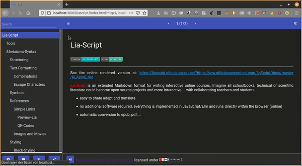
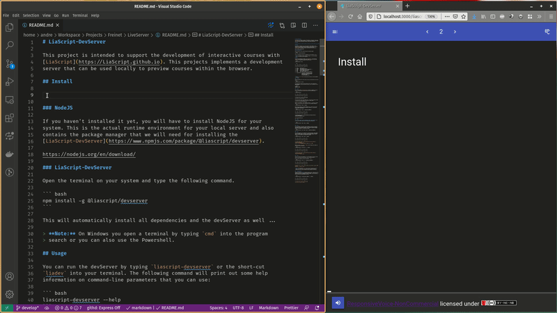

# LiaScript-DevServer

This project is intended to support the development of interactive courses with
[LiaScript](https://LiaScript.github.io). This projects implements a development
server that can be used locally to preview courses within the browser.

## Installation

You can directly download the latest version for your system from the assets:

https://github.com/LiaScript/LiaScript-DevServer/releases/

or install it via the NodeJS package manager `npm` ...

### NodeJS

If you haven't installed it yet, you will have to install NodeJS for your
system. This is the actual runtime environment for your local server and also
contains the package manager that we will need for installing the
[LiaScript-DevServer](https://www.npmjs.com/package/@liascript/devserver).

https://nodejs.org/en/download/

### LiaScript-DevServer

Open the terminal on your system and type the following command.

```bash
npm install -g @liascript/devserver
```

This will automatically install all dependencies and the devServer as well ...

> **Note:** On Windows you open a terminal by typing `cmd` into the program
> search or you can also use the Powershell.

## Usage

You can run the devServer by typing `liascript-devserver` or the short-cut
`liadev` into your terminal. The following command will print out some help
information on command-line parameters that you can use:

```bash
liascript-devserver --help
```

```text
 _     _       ____            _       _
| |   (_) __ _/ ___|  ___ _ __(_)_ __ | |_
| |   | |/ _` \___ \ / __| '__| | '_ \| __|
| |___| | (_| |___) | (__| |  | | |_) | |_
|_____|_|\__,_|____/ \___|_|  |_| .__/ \__|
                                |_|

-h  --help       show this help
-v  --version    show version information
-i  --input      input README.md file or folder (default: .)
-p  --port       used port number (default: 3000)
-l  --live       do live reload on file change
-o  --open       open in default browser
-t  --test       test online on https://LiaScript.github.io
    --mcp        serve as MCP server on stdio for AI agents,
                 to be started from the MCP config of the agent

-r  --responsiveVoice  add optional responsiveVoice support,
                       or pass your own responsiveVoice key.
                       Adding this feature might slow down
                       the reloading speed.
                       For more information visit:
```

> **Note:** `-h` or `--help` will only print out the help, all other parameters
> are ignored.

### `--version`

Use this to identify the current version, but you can alternatively also use the
shortcut `-v`:

```bash
liascript-devserver --version
```

At the moment this should give the following results. Since LiaScript gets
updated separately, we use two different version, one for the devServer and one
for LiaScript.

```text
DevServer: 1.3.0
LiaScript: 2.6.2
```

### `--input`

If you run the command `liascript-devserver` without any commands, the server
will run from your current directory and give you the following output.

```text
$ liascript-devserver

 _     _       ____            _       _
| |   (_) __ _/ ___|  ___ _ __(_)_ __ | |_
| |   | |/ _  \___ \ / __| '__| | '_ \| __|
| |___| | (_| |___) | (__| |  | | |_) | |_
|_____|_|\__,_|____/ \___|_|  |_| .__/ \__|
                                |_|

📡 starting server
   - local:           http://localhost:3000
   - on your network: http://192.168.2.114:3000
✨ hit Ctrl-c to close the server
```

The server starts locally on port 3000, thus, if you open your browser and type
in the URL http://localhost:3000 you should see a similar image


However, if you add the `--input` parameter (shortcut `-i`) and pass it another
folder, this will be used as the root folder for the subsequent navigation.

```bash
liascript-devserver --input ../LiaBooks
```

But you can also refer to a specific Markdown file, in this case, the course
will be rendered immediately by the LiaScript interpreter, if you open the
following link in your browser.

```bash
liascript-devserver --input ../LiaBooks/docs/README.md

...
📡 starting server
   - local:           http://localhost:3000/liascript/index.html?http://localhost:3000/README.md
   - on your network: http://192.168.2.114:3000/liascript/index.html?http://192.168.2.114:3000/README.md
✨ hit Ctrl-c to close the server
```



### `--open`

**If you want to open the preview immediately, then use this parameter.** It
will open your default browser with the displayed URL automatically.

```bash
liascript-devserver --open -i ../LiaBooks
```

### `--live`

Use this parameter if you want to have live updates. The server will monitor
file changes within the defined folder. When you type and save your document, a
reload will be automatically triggered. If you prefer to reload your changes
manually via pressing `F5` do not use this option.

```bash
liascript-devserver --live -o -i ../LiaBooks/docs/README.md
```



### `--port`

It is only possible to run on devServer at a given port-number, thereby 3000 is
used as the default value. If you want to start multiple servers on different
folders or the port-number is already occupied by another process or server,
this will will be shown by the following error message:

```bash
liascript-devserver -o -i ../LiaBooks

...
📡 starting server
   - local:           http://localhost:3000/liascript/index.html?http://localhost:3000/README.md
   - on your network: http://192.168.2.114:3000/liascript/index.html?http://192.168.2.114:3000/README.md
✨ hit Ctrl-c to close the server
🚨 error => listen EADDRINUSE: address already in use :::3000
```

However, by using `--port 3001` or `-p 3001` you can redefine this number and
run different servers separately:

```bash
liascript-devserver --port 3001 -o -i ../LiaBooks

...
📡 starting server
   - local:           http://localhost:3001/liascript/index.html?http://localhost:3001/README.md
   - on your network: http://192.168.2.114:3001/liascript/index.html?http://192.168.2.114:3001/README.md
✨ hit Ctrl-c to close the server
```

### `--test`

Since we are using a local devServer, it is also possible to test your courses
online on the LiaScript project website: https://LiaScript.github.io

See how the URL changes by setting the parameter `--test`:

```bash
liascript-devserver --test -o -i ../LiaBooks/docs/README.md

...
📡 starting server
   - local:           https://LiaScript.github.io/course/?http://localhost:3000/README.md
   - on your network: https://LiaScript.github.io/course/?http://192.168.2.114:3000/README.md
✨ hit Ctrl-c to close the server
```

> **Note:** Live reload with `--live` will not work in this mode, since the
> server is only used to serve local data and not the LiaScript website.
> Additionally you will have to remove the courses manually from the index.

### `--responsiveVoice`

Automated Text2Speech is **Not** enabled by default, since it reduces the reload
speed. But you can add this support by add this parameter, in this case the
LiaScript project key is automatically injected. However, you can also pass your
own key from your own project/website like this:

```bash
$ liascript-devserver --responsiveVoice YOURKEY -i ../LiaBooks
```

### `--mcp`

Connects the preview to an AI agent such as Claude Code, Codex or Gemini CLI.
With this parameter the devServer is additionally an
[MCP](https://modelcontextprotocol.io) server on stdio. You do not start it
yourself, the agent does. For Claude Code put this `.mcp.json` next to your
course:

```json
{
  "mcpServers": {
    "liascript": {
      "command": "liadev",
      "args": ["--mcp", "--live", "-i", "README.md"]
    }
  }
}
```

For Codex add this to `~/.codex/config.toml`. Codex gives up on a tool call
after 60 seconds by default, which is too short for a question the user has to
answer:

```toml
[mcp_servers.liascript]
command = "liadev"
args = ["--mcp", "--live", "-i", "/path/to/README.md"]
tool_timeout_sec = 3600
```

Every agent starts a devServer of its own. If the port is taken, the next free
one is used, so several of them can run from the same config, and the agent
learns the address from `get_state`. This matters in VS Code, which starts the
servers of a `.mcp.json` in the workspace for Copilot as well, next to the one
Claude Code starts. Do not start `--mcp` yourself in a terminal: nothing can
connect to that instance.

The preview opens in your default browser. If the agent has browser automation
tools, such as the MCP servers of Playwright or Chrome DevTools, it is told to
open the preview in that browser instead, as long as no tab is connected yet.
You and the agent then look at the same tab, and the agent can take
screenshots, read the console and click in the course. Open the preview
yourself first if you prefer your own browser: the agent uses the tab that is
there and never opens a second one.

The agent gets these tools:

| Tool             | What it does                                                                                                   |
| ---------------- | -------------------------------------------------------------------------------------------------------------- |
| `get_state`      | the open course, the slide (1-based, like `#3` in the URL), its title, the text you have selected, and whether the browser can read aloud |
| `goto`           | show a `slide`, the slide of a source `line`, or another course `file`; opens the browser if it is not open    |
| `chat`           | write into the chat on top of the course, optionally with buttons, radio buttons and checkboxes for you to answer |
| `wait_for_event` | fallback for agents that cannot be notified, see below                                                         |

#### Reading aloud

LiaScript reads a course aloud with the speech voices of the browser. The
devServer reports to the agent how many voices the browser has, and when there
are none, `get_state` carries a `tts` entry that says why and what helps. The
agent is told to change nothing without asking you.

The chat uses the same voices: every message has a small button that reads it
aloud in the language of the course, without code blocks, tables and diagrams.
A browser without voices shows no such button. The agent can say that a
message is in another language, and mark single passages, so that each part is
read with a matching voice.

| Browser                                   | Why it is silent                                                                  | What helps                                                                 |
| ----------------------------------------- | --------------------------------------------------------------------------------- | -------------------------------------------------------------------------- |
| Chrome started by the Playwright MCP      | it starts Chrome with `--disable-component-extensions-with-background-pages`, which removes Chrome's online voices | a config file that drops the flag, see below (checked with Playwright MCP 0.0.83, Chrome 154) |
| Chrome started by another automation tool | the same flag                                                                     | start Chrome without it                                                    |
| Firefox on Linux                          | it takes its voices from `speech-dispatcher`                                      | install `speech-dispatcher` with a voice                                   |
| any browser                               |                                                                                   | start the devServer with `--responsiveVoice <key>` and a valid key, that service needs no browser voices |

For the Playwright MCP, write this into a file and pass it with `--config` or
the environment variable `PLAYWRIGHT_MCP_CONFIG`, then restart that server:

```json
{
  "browser": {
    "launchOptions": {
      "ignoreDefaultArgs": ["--disable-component-extensions-with-background-pages"]
    }
  }
}
```

The voices of Chrome are online voices of Google: the text that is read goes
to Google, and without a connection it stays silent.

#### Links that talk to the agent

A link with the scheme `agent:` sends a command to the agent when you click it.
The message is the link itself, `agent:<agent>/<command>?<parameters>`. Written
as `agent://<agent>/<command>?<parameters>` it means the same:

```markdown
[Explain this simpler](agent:tutor/explain?level=easy)

<button data-agent="agent:author/rewrite?tone=short">Shorten this section</button>

[Give me an exercise](#)<!-- data-agent="agent:tutor/exercise?n=3" -->
```

The agent receives the agent name, the command and the parameters together
with what you are looking at: file, slide, title and selected text. What
`tutor` or `explain` mean is up to you. Define them as sub-agents, skills or
simply in the instructions of your agent. The same links work in the chat, so
the agent can offer them to you as well.

Outside of the devServer such a link leads nowhere; the `data-agent` forms are
inert there.

Claude Code is told about a click at once, in one of two ways:

- Its [channels](https://code.claude.com/docs/en/channels) are a research
  preview and work only in the terminal, not in the chat panel of the VS Code
  extension. The session has to be started like this:

  ```bash
  claude --dangerously-load-development-channels server:liascript
  ```

- Otherwise it listens with its Monitor tool, in the terminal and in VS Code
  alike. `get_state` gives it the address of an event stream, the agent runs
  `curl -sN` on it in the background, and every click wakes it up. The agent is
  told to do so, there is nothing to set up. While it listens, forms in the
  chat do not keep it waiting; your answer arrives like a click.

Other agents cannot be notified by an MCP server. Ask them to call
`wait_for_event` in a loop instead, it returns as soon as you click.

Closing the preview is an event as well: two seconds after the last browser
went away the agent is told that nobody is looking anymore, a form it was
waiting for ends, and it is asked not to reopen the page on its own. A reload
is too short to count.

#### The chat

In this mode a course opens inside a page with a chat on top of it. The course
lives in a frame of its own, so the chat stays when the course reloads. What
you type goes to the agent, and its answers are rendered as Markdown, including
` ```mermaid ` diagrams. While the agent works on an answer, a line below the
messages tells what it is doing. Markdown and diagram rendering are loaded from
jsDelivr; without a connection the chat falls back to plain text.

#### Security

What happens in the browser ends up as a prompt for your agent. Therefore, with
`--mcp` the server listens on this machine only and refuses requests from other
origins. The event stream answers only at a random address that the agent gets
from `get_state`, and never to a browser. Course content is still able to send
commands, that is the point of the links, and scripts of a course can do the
same. Open courses you do not trust without `--mcp`.
